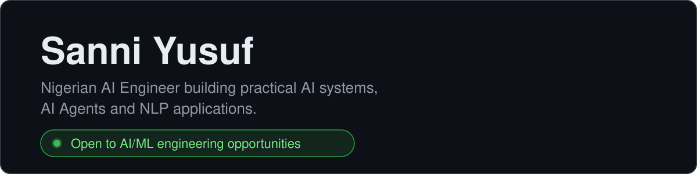
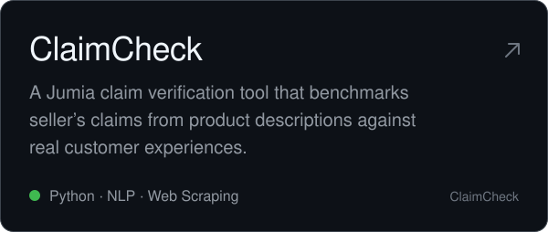
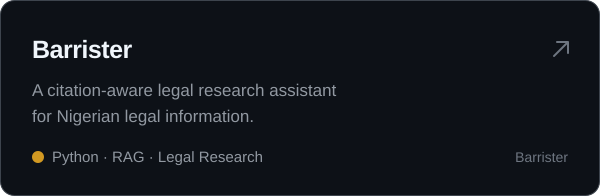
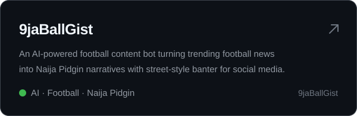
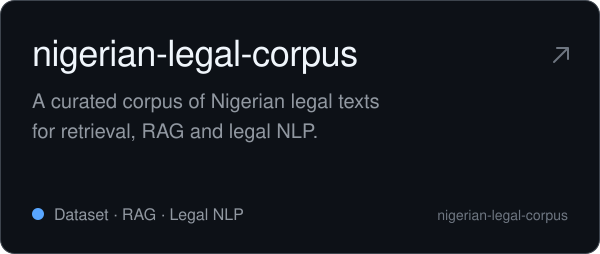

<picture>
  <source media="(prefers-color-scheme: dark)" srcset="assets/header-dark.svg">
  
</picture>

  <a href="mailto:ysanni560@gmail.com">Email</a>&nbsp;&nbsp;·&nbsp;&nbsp;<a href="https://linkedin.com/in/sanniyusuf">LinkedIn</a>&nbsp;&nbsp;·&nbsp;&nbsp;<a href="https://x.com/s4nni_yusuf">X</a>

  I build practical AI systems for the Nigerian context. I like turning ideas into things that actually work, and I curate the datasets behind many of my projects

## Featured Projects

  
  

  
  

  

Issues, feedback and pull requests are welcome. Each project's README covers setup and current scope.

## Stack

<!-- 

  &nbsp;
  &nbsp;
  &nbsp;
  &nbsp;
  &nbsp;
  

 -->

<!-- **Languages:** TypeScript, JavaScript, Python, SQL, Dart and Rust. 
**Backend and data:** Node.js, NestJS, PostgreSQL, pgvector, MongoDB and Redis. 
**Web and mobile:** React, Next.js and Flutter. 
**Infrastructure:** Docker, AWS, Cloudflare R2 and GitHub Actions. -->
