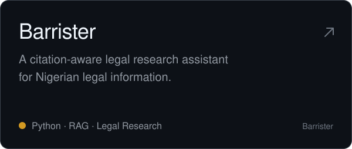
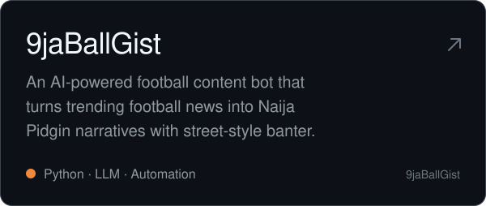
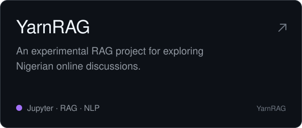

<picture>
  <source media="(prefers-color-scheme: dark)" srcset="assets/banners/header-dark.svg">
  
</picture>

  <a href="mailto:ysanni560@gmail.com">Email</a>&nbsp;&nbsp;·&nbsp;&nbsp;<a href="https://linkedin.com/in/sanniyusuf">LinkedIn</a>&nbsp;&nbsp;·&nbsp;&nbsp;<a href="https://x.com/s4nni_yusuf">X</a>

  I build practical AI systems for the Nigerian context. I like turning ideas into things that actually work, and I curate the datasets behind many of my projects

## Featured Projects

  
  

  
  

  

Issues, feedback and pull requests are welcome. Each project's README covers setup and current scope.

## Stack

  &nbsp;
  &nbsp;
  &nbsp;
  &nbsp;
  &nbsp;
  

**Language and data:** Python, pandas and NumPy. 
**AI and NLP:** Hugging Face, spaCy, PyTorch and scikit-learn. 
**RAG and LLMs:** LangChain, LlamaIndex, Chroma, OpenRouter. 
**AI agents:** LangGraph and Smolagents. 
**Backend:** FastAPI and Docker 
**Prototyping:** Streamlit. 
**Data collection:** Beautiful Soup and Playwright. 
